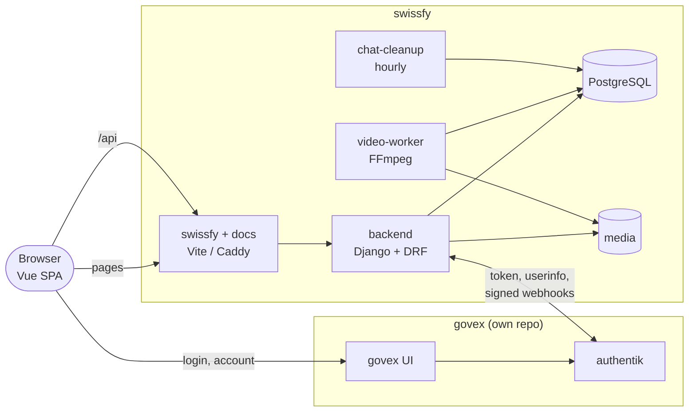
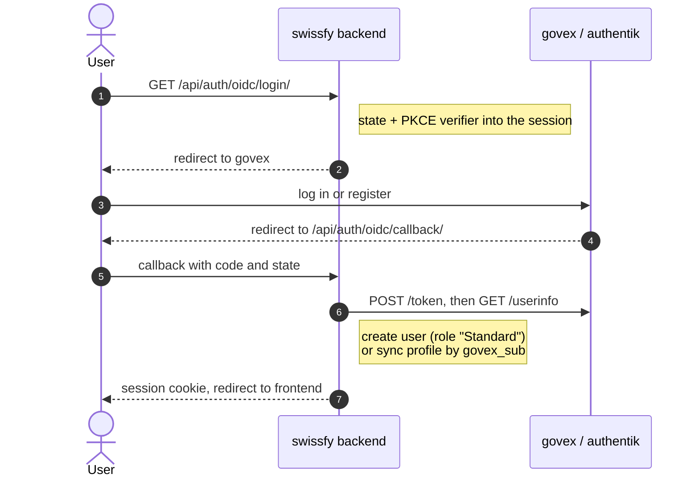
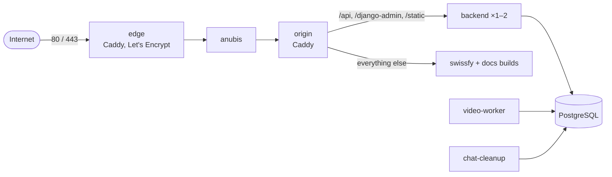

# Swissfy

Swissfy is a social network: posts with images and videos, reels, stories,
comments, hashtags, friends and followers, end-to-end encrypted chats,
notifications, achievements and moderation.

The repo holds a Django REST backend (`backend/`) and two Vue frontends that
share `frontend/core`: `frontend/swissfy` is the app itself, `frontend/docs` is
the public changelog at `docs.swissfy.ch`. The setup mirrors wintersehn.

Login goes through [govex](https://github.com/NEOTYRA/govex) (authentik, OIDC).
swissfy stores no passwords; username, email, name, birthdate and avatar come
from govex.

## Stack

Backend: Python 3.13, Django 6, Django REST framework, PostgreSQL 17,
cryptography (AES-GCM), Pillow, FFmpeg, gunicorn and WhiteNoise.

Frontend: Vue 3 with the Options API, Vue Router, Pinia, Vite, Tailwind 4,
daisyUI 5, and `@noble/post-quantum` for the chat key exchange.

Infrastructure: Docker Compose locally and in production, Caddy as proxy and
for TLS, and Anubis for bot protection. Images are hosted on Docker Hub.

Exact versions are in `backend/requirements.txt` and the `package.json` files.

## Architecture



The browser only ever talks to one origin. Vite (dev) or Caddy (prod) proxies
`/api` to the backend. Authentication uses a plain Django session cookie, so
there are no tokens in the browser.

### Backend apps

All apps live under `backend/swissfy/` and revolve around the user from
`accounts`. They depend on each other on purpose and import each other freely
instead of forming layers. For example, a like creates a notification, a block
hides posts and chats, and a suspension stops posting.

| URL prefix             | App                                         |
| ---------------------- | ------------------------------------------- |
| `/api/auth/`           | `accounts`: login, me, consent              |
| `/api/social/`         | `social`: friends, follows, blocks, nicknames |
| `/api/chats/`          | `chats`                                     |
| `/api/` (posts, …)     | `posts`, `moderation`                       |
| `/api/administration/` | `accounts.administration`                   |
| `/api/notifications/`  | `notifications`                             |
| `/api/internal/`       | `accounts`: profiles for wintersehn's monolith, token protected |
| `/api/docs/`           | `docs`: changelogs, public                  |
| `/api/health/`         | `main`                                      |
| `/django-admin/`       | Django admin                                |

Every user has a `UserProfile` that holds the link to govex (`govex_sub`).
Roles are Django groups: `Admin`, `Moderator`, `Verifiziert`, `Standard`.

Post texts, comments, stories, biographies and all uploaded media are encrypted
at rest using `CONTENT_ENCRYPTION_KEYS` (`commons/encryption.py`,
`EncryptedTextField`, `EncryptedFileSystemStorage`).

### Login with govex

This is an authorization code flow with PKCE. The code is exchanged server to
server, and the browser only receives swissfy's session cookie.



Accounts are matched by `govex_sub` only, never by email, because govex does
not verify emails. Existing local accounts can be linked with
`link_govex_user`.

govex notifies swissfy about account changes through
`/api/auth/oidc/account-updated/` and `/api/auth/oidc/account-deleted/`.
Both requests are signed with HMAC-SHA256, and swissfy accepts at most 5
minutes of clock skew.

### Chat encryption

Messages are encrypted in the browser. Each message gets a random AES-256-GCM
key. That key is sealed once per recipient device with ML-KEM-768 + ECDH P-256
combined through HKDF. The backend stores ciphertext and envelopes only.

| Protection | Where the private key lives                          | Server can read? |
| ---------- | ---------------------------------------------------- | ---------------- |
| `standard` | the message key is also wrapped with `CHAT_ENCRYPTION_KEY`, so chats work on every device | yes |
| `device`   | non-extractable key in this browser only             | no               |
| `pin`      | encrypted with a PIN (PBKDF2, 600k iterations), stored on the server | no |

If either participant uses `standard`, the server key is attached. Messages
are deleted after 14 days by `chat-cleanup`. Slow mode allows one message
every 5 seconds per chat. The chat view polls every 3 seconds; there are no
websockets yet.

### Videos

Uploads are validated in the request (max. 250 MB, 60 seconds) and get the
status `processing`. `video-worker` (`manage.py process_videos`) picks them up
every 5 seconds and transcodes them to H.264/AAC with at most 1280px and a
thumbnail. The post then ends up as `ready` or `failed`.

### Production



`edge` tags each request with `X-Swissfy-App` (`swissfy` or `docs`), and
`origin` serves the matching build. `origin` resolves `backend` via DNS every
5 seconds and health-checks it. That is what lets `bin/deploy` run two
backends side by side.

## Code culture

The code follows a strong house style. It is consistent throughout, and it is
unusual enough that it is worth reading this section before your first change.

The strictness is deliberate. Vibe coding produces masses of bloated,
unreadable code: defensive checks for cases that cannot happen, comments that
repeat the line below, a new helper for every problem and three ways of doing
the same thing. It is painful to read, painful to debug, painful to review and
painful to change. Nobody really understands it, including whoever generated
it.

This codebase does not accept that. The style is narrow on purpose, so that
kind of code stands out in review right away. Every change has to fit the
existing patterns, and fitting them means understanding them first.

When in doubt, find the place where the same problem
is already solved and do it the same way.

### Backend

**Logic lives in querysets and models, not in views.** Views chain named
queryset methods that read like the domain:

```python
Post.objects.feed(user).videos()
SavedPost.objects.filter(user=user).in_folder(folder)
PostCreation.objects.filter(author=user).stale().delete()
```

Each model's queryset implements `apply_acl(user)`, which returns exactly what
the user may see. Visibility is built in SQL from `Q` and `Exists`
(`AudienceQuerySet.with_audience`), never by filtering in Python. A new
endpoint starts from `apply_acl`, not from `objects.all()`.

**Views are thin and configured, not branched.** Every viewset extends
`commons.views.BaseViewSet`:

- `permission_action_classes` and `pagination_action_classes` map an action to
  its permissions or pagination, which replaces `if self.action == ...`.
- `respond(instance)` reloads the instance through `get_queryset()`, so the
  response carries the same annotations as a list.
- `CreateModelMixin` and `UpdateModelMixin` from `commons.views` return through
  `respond`. `perform_create` returns the saved object.

**Serializers are grouped into variants.** A `BaseModelSerializer` is not a
serializer itself. It is a container of nested serializer classes:

```python
class PostModelSerializer(UUIDModelSerializer):
    class read(...): ...
    class write(...): ...
    class audience(...): ...
```

`for_action` picks `read` for `list`/`retrieve` and `write` for everything
else. Other variants (`.audience`, `.device`, `.query`) are chosen explicitly.
Query parameters are validated through a serializer too, not read raw.

**The server decides, the client displays.** States like `can_request`,
`blocked_reason`, `unavailable` and `can_view` are computed in the backend and
sent ready to use. The frontend does not recompute permissions.

**Concurrency is handled explicitly.** Anything that counts or limits locks
first: `select_for_update` for the post quota and `lock_users` before chat
messages and chat requests, both inside `transaction.atomic`.

**User-facing messages are German** and are raised directly from the backend
(`BadRequest`, `Conflict`, `RetryLater` in `commons.exceptions`). The frontend
shows `error.detail` as it is.

### Rules that apply everywhere

- No comments and no docstrings. A name that needs a comment is the wrong
  name.
- No `getattr`, `setattr`, `isinstance`, `defaultdict` or
  `operator.attrgetter` in Python. No `setTimeout` or `nextTick` in Vue. They
  usually hide a missing structure; solve it with an explicit mapping, a
  variant or a separate method instead.
- Short names from the domain: `respond`, `paginated`, `like_state`,
  `incoming_request`.
- Formatting is not up for discussion: black and isort (line length 100),
  flake8, Prettier, ESLint and oxlint. CI fails otherwise, as it does for
  missing migrations.

### Frontend

- Components use the Options API (`export default { data, computed, methods }`).
  Stores use Pinia's setup syntax.
- Every request goes through a module in `src/api/`, which builds on
  `@core/api/client.js`. Components do not build URLs.
- Styling uses Tailwind and daisyUI classes in the template, with the shared
  components from `components/common` (`BaseButton`, `BaseCard`, `AppIcon`,
  …). Every button has an `AppIcon`.
- Reusable logic without UI goes into `src/lib/` (chat crypto, time, links).

### Tests

Tests are Django `TestCase`s next to the app and split by intent:

| File               | What it covers                                          |
| ------------------ | ------------------------------------------------------- |
| `tests.py`         | behaviour of the endpoints                              |
| `test_security.py` | access control, input that must be rejected             |
| `test_matrix.py`   | every combination of visibility, audience and relation  |
| `main/test_performance.py` | query counts, so N+1 regressions fail          |

Frontend tests (Vitest) live in `frontend/swissfy/tests`, with security tests
for rendering, links and chat crypto under `tests/security`.

## Getting started

You need Docker with Compose and SSH access to GitHub. Python and Node are only
needed locally for editor support (Python 3.13, Node `^22.18.0 || >=24.12.0`).

Clone govex next to swissfy:

```sh
cd ~/projects
git clone git@github.com:NEOTYRA/govex.git
git clone git@github.com:buechijonas/swissfy.git
```

govex already ships with a dev OIDC client for swissfy
(`swissfy-dev` / `swissfy-dev-secret`), so no setup is needed on that side.

Start govex first. The first start takes a few minutes, until
http://localhost:5174 shows the login page:

```sh
cd ~/projects/govex && docker compose up -d
```

Then start swissfy:

```sh
cd ~/projects/swissfy && docker compose up --build
```

| Container      | What it does                                                    |
| -------------- | --------------------------------------------------------------- |
| `db`           | PostgreSQL 17                                                   |
| `backend`      | migrates, creates the admin user, runs `runserver` with reload  |
| `swissfy`      | Vite dev server for the app                                     |
| `docs`         | Vite dev server for the changelog                               |
| `video-worker` | transcodes uploaded videos                                      |
| `chat-cleanup` | deletes chat messages older than 14 days, hourly                |

| Service         | URL                                 | Login             |
| --------------- | ----------------------------------- | ----------------- |
| swissfy         | http://localhost:5175               | via govex         |
| docs            | http://localhost:5176               | public            |
| API             | http://localhost:8001/api/          | –                 |
| Django admin    | http://localhost:8001/django-admin/ | `admin` / `admin` |
| govex           | http://localhost:5174               | –                 |
| authentik admin | http://localhost:9000/if/admin/     | `akadmin` / `admin` |
| Mailpit         | http://localhost:8025               | –                 |

The ports do not collide with wintersehn (5173/8000), so all three stacks can
run at once. The source code is mounted into the containers. Only changes to
`requirements.txt`, `package.json` or a Dockerfile need `--build`.

To log in, open http://localhost:5175 and register in govex. Verification
emails end up in Mailpit. To make your account an admin, give it the `Admin`
group in the Django admin, or link it to an existing swissfy user:

```sh
docker compose exec backend python manage.py link_govex_user <username> <govex-sub>
```

The govex sub is the user's UUID in the authentik admin, under
Directory → Users.

For demo data, run `docker compose exec backend python manage.py seed_demo`.
It creates `demo_*` users with every combination of roles, posts, relations,
chats and sanctions. `--seed <n>` changes the seed.

## Everyday commands

Run these from the repo root while the stack is up.

| Task                  | Command                                                               |
| --------------------- | --------------------------------------------------------------------- |
| Backend tests         | `docker compose run --rm backend python manage.py test`               |
| Tests of one app      | `docker compose run --rm backend python manage.py test swissfy.posts` |
| Migrations            | `docker compose exec backend python manage.py makemigrations`         |
| Django shell          | `docker compose exec backend python manage.py shell`                  |
| Format backend        | `docker compose exec backend sh -c "isort . && black ."`              |
| Lint backend          | `docker compose exec backend flake8`                                  |
| Frontend tests        | `docker compose exec swissfy npm test`                                |
| Lint / format frontend | `docker compose exec swissfy npm run lint` / `npm run format` (same for `docs`) |
| Production build      | `docker compose exec swissfy npm run build`                           |
| Proxy image test      | `bin/test-proxy`                                                      |
| Wipe all data         | `docker compose down -v`                                              |

After adding a frontend dependency, the `node_modules` volume needs to be
recreated:

```sh
docker compose down
docker volume rm swissfy_swissfy_node_modules   # or swissfy_docs_node_modules
docker compose up --build
```

## Project structure

```
backend/
  main/          settings, URLs, health, pagination, middleware
  commons/       base viewset, serializer and model classes, encryption, storage
  swissfy/
    accounts/    govex login (oidc.py), profile, consent, roles, administration
    social/      friend and follow requests, blocks, nicknames
    posts/       posts, stories, videos, comments, hashtags, saved, contact groups
    chats/       encrypted chats and keys
    notifications/
    moderation/  reports, warnings, suspensions
    achievements/ badges, themes, easter eggs
  docs/          changelogs (changelogs/vX.Y.Z.md)
frontend/
  core/src/      shared by both apps: API client, cookies, settings, fonts
  swissfy/src/   api/, components/, views/, stores/, lib/, data/, router/
  docs/src/      changelog app
docker/proxy/    production Caddy image, builds both frontends
bin/             release, deploy, test-proxy
```

## Production

Production runs on prebuilt images (`buechijonas/swissfy-backend`,
`buechijonas/swissfy-proxy`) with `compose.prod.yml`, `bin/deploy` and a `.env`
on the server, usually in `/opt/swissfy`. The DNS records for the domain and
`docs.<domain>` must point to the server, with ports 80 and 443 open.

### `.env`

`.env.example` is the template. Hostnames, origins, the cookie domain and the
redirect URI are derived from `DOMAIN` in `compose.prod.yml`.

| Variable                  | Purpose                                                        |
| ------------------------- | -------------------------------------------------------------- |
| `DOMAIN`, `ACME_EMAIL`    | public domain and Let's Encrypt contact                        |
| `DJANGO_SECRET_KEY`       | Django secret key                                              |
| `CONTENT_ENCRYPTION_KEYS` | `id:key` list, newest first, for content and media at rest     |
| `CHAT_ENCRYPTION_KEY`     | server key for `standard` chat protection                      |
| `CONSENT_PRIVATE_KEY`     | signs the consent status pushed to govex (`manage.py consent_signing_key`) |
| `DB_NAME`, `DB_USER`, `DB_PASSWORD` | PostgreSQL                                           |
| `ADMIN_USERNAME`, `ADMIN_EMAIL`, `ADMIN_PASSWORD` | Django admin, created once and never overwritten |
| `GOVEX_PUBLIC_URL`, `GOVEX_ACCOUNT_URL` | govex login and account page                     |
| `GOVEX_CLIENT_ID`, `GOVEX_CLIENT_SECRET` | must match `SWISSFY_CLIENT_*` in govex's `.env` |
| `MONOLITH_API_TOKEN`      | enables `/api/internal/` for wintersehn; empty disables it     |

Generate the secrets:

```sh
python3 -c "import secrets; print(secrets.token_urlsafe(50))"
python3 -c "import base64, os; print(base64.b64encode(os.urandom(32)).decode())"
```

`CHAT_ENCRYPTION_KEY` is missing from `.env.example` and has to be added by
hand. Do not change it once chats exist, and never drop a content key that is
still in use, or the data can no longer be decrypted.

With `DJANGO_DEBUG=false` the backend refuses to start if a secret, an
encryption key, the consent key or a govex variable is missing.

### Release and deploy

`bin/release` runs on a clean, up-to-date `master`. It asks for the bump type,
bumps `frontend/swissfy/package.json`, writes
`backend/docs/changelogs/vX.Y.Z.md`, commits and pushes. Then it builds and
pushes both images for `linux/amd64` (`latest` and `vX.Y.Z`) and creates a
GitHub release.

On the server, `./deploy` pulls the images and starts a second backend next to
the old one. Once the new one is healthy, it removes the old backend and
recreates the proxies. If the new backend never becomes healthy, it is removed
and the old one keeps running.

## Troubleshooting

**Login fails or hangs.** govex is not up yet. The backend reaches authentik
through `host.docker.internal:9000`, so port 9000 has to be free.

**Port already in use.** 5174, 5175, 5176, 8001 or 9000 is taken by another
stack. Stop it or change the port in `compose.yml`.

**A package is missing after `npm install`.** The `node_modules` volume is
stale, see [Everyday commands](#everyday-commands).

**Videos stay in "processing".** Check `docker compose logs video-worker`.
