# Swissfy

Swissfy is a social network: posts with images and videos, reels, comments,
hashtags, friends and followers, end-to-end encrypted chats, notifications,
achievements and moderation.

It consists of a Django REST backend (`backend/`) and a Vue frontend
(`frontend/`), set up like wintersehn. Login goes through
[govex](https://github.com/NEOTYRA/govex) (authentik, OIDC): swissfy keeps no
passwords, username, email, name, birthdate and avatar come from govex.

## Contents

- [Tech stack](#tech-stack)
- [Architecture](#architecture)
- [Prerequisites](#prerequisites)
- [Repositories](#repositories)
- [Local development](#local-development)
- [Everyday commands](#everyday-commands)
- [Project structure](#project-structure)
- [Configuration](#configuration)
- [Production](#production)
- [Troubleshooting](#troubleshooting)

## Tech stack

### Backend

| Package                                         | Version | Purpose                                     |
| ----------------------------------------------- | ------- | ------------------------------------------- |
| [Python](https://www.python.org/)               | 3.13    | Runtime (`python:3.13-slim` image)          |
| [Django](https://www.djangoproject.com/)        | 6.0     | Web framework, ORM, admin                   |
| [Django REST framework](https://www.django-rest-framework.org/) | 3.17 | REST API                       |
| [PostgreSQL](https://www.postgresql.org/)       | 17      | Database (`postgres:17-alpine` image)       |
| [psycopg](https://www.psycopg.org/)             | 3.2     | PostgreSQL driver                           |
| [cryptography](https://cryptography.io/)        | 46      | AES-GCM encryption of chat message keys     |
| [Pillow](https://python-pillow.org/)            | 12      | Image processing for uploads                |
| [FFmpeg](https://ffmpeg.org/)                   | –       | Video transcoding and thumbnails            |
| [requests](https://requests.readthedocs.io/)    | 2.34    | OIDC token/userinfo calls to govex          |
| [gunicorn](https://gunicorn.org/)               | 23      | WSGI server in production                   |
| [WhiteNoise](https://whitenoise.readthedocs.io/) | 6.11   | Static files in production                  |
| black, isort, flake8                            | –       | Formatting and linting                      |

All pinned in `backend/requirements.txt`.

### Frontend

| Package                                         | Version | Purpose                                     |
| ----------------------------------------------- | ------- | ------------------------------------------- |
| [Node.js](https://nodejs.org/)                  | 24      | Runtime (`node:24-alpine` image)            |
| [Vue](https://vuejs.org/)                       | 3.5     | UI framework                                |
| [Vue Router](https://router.vuejs.org/)         | 5       | Routing                                     |
| [Pinia](https://pinia.vuejs.org/)               | 4       | State management (`src/stores`)             |
| [Vite](https://vite.dev/)                       | 8       | Dev server and build                        |
| [Tailwind CSS](https://tailwindcss.com/)        | 4       | Styling                                     |
| [daisyUI](https://daisyui.com/)                 | 5       | Tailwind component library                  |
| [@noble/post-quantum](https://github.com/paulmillr/noble-post-quantum) | 0.7 | Client-side chat key exchange |
| ESLint, oxlint, Prettier                        | –       | Linting and formatting                      |

All listed in `frontend/package.json`.

### Infrastructure

| Tool                                            | Purpose                                                    |
| ----------------------------------------------- | ---------------------------------------------------------- |
| [Docker](https://www.docker.com/) + Compose     | Runs everything, locally and in production                 |
| [authentik](https://goauthentik.io/) (via govex) | Identity provider, OIDC                                   |
| [Caddy](https://caddyserver.com/)               | Serves the frontend build, reverse proxy, TLS (Let's Encrypt) |
| [Anubis](https://github.com/TecharoHQ/anubis)   | Bot protection in front of the app                         |
| [GitHub CLI](https://cli.github.com/)           | Creating releases (`bin/release`)                          |
| [Docker Hub](https://hub.docker.com/)           | Hosts the production images                                |

## Architecture

### Overview

swissfy is a single-page app talking to a JSON API. It owns all social data
(posts, chats, relations, moderation), govex owns identities. Two background
workers run off the same backend image.

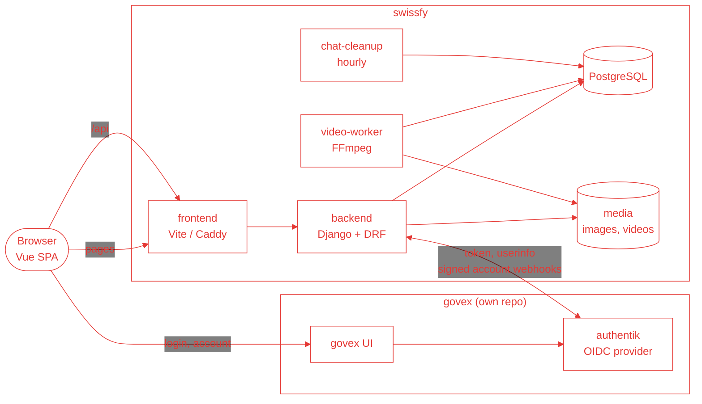

The frontend never talks to the backend across origins: in development Vite
proxies `/api` to the backend, in production Caddy does. Authentication is a
plain Django session cookie, so there are no tokens in the browser.

### Backend apps

Every app is built around the user from `accounts`. The apps work closely
together (e.g. a like creates a notification, a block hides posts and chats,
a suspension blocks posting), so they import each other freely rather than
forming strict layers.

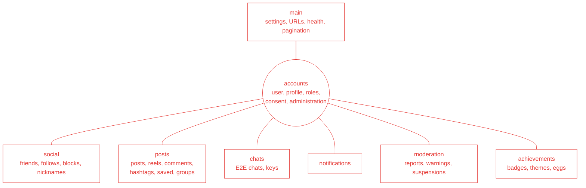

| URL prefix               | App                           |
| ------------------------ | ----------------------------- |
| `/api/auth/`             | `accounts` (login, me, consent) |
| `/api/social/`           | `social`                      |
| `/api/chats/`            | `chats`                       |
| `/api/` (posts, …)       | `posts`, `moderation`         |
| `/api/administration/`   | `accounts.administration`     |
| `/api/notifications/`    | `notifications`               |
| `/api/health/`           | `main`                        |
| `/django-admin/`         | Django admin                  |

### Data model (simplified)

Every user comes from govex and has a `UserProfile` holding the link
(`govex_sub`). Roles are Django groups.

**Users and relations**

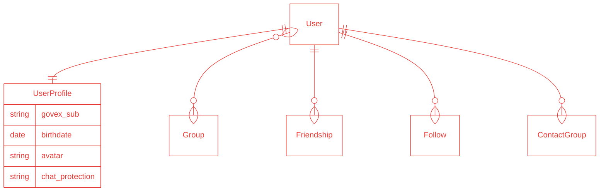

**Posts**

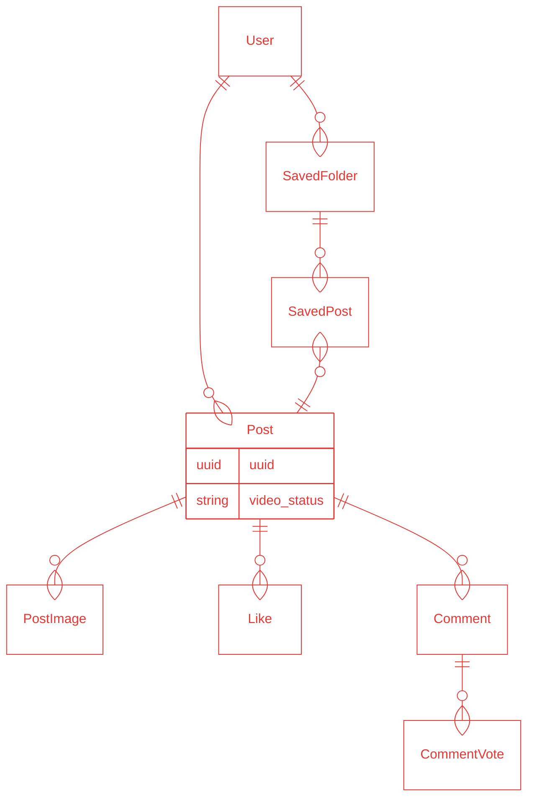

**Chats, moderation and notifications**

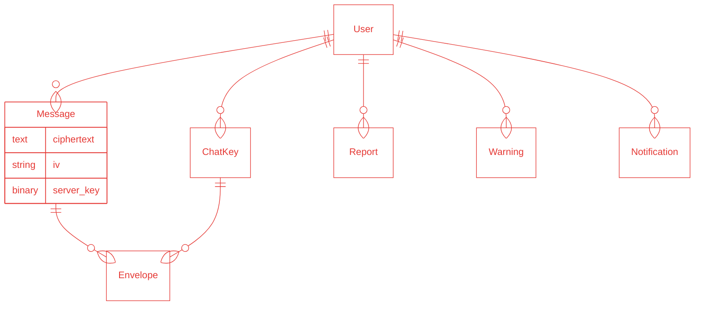

`Envelope` holds the message key sealed for one recipient key, `server_key`
is only set for the `standard` chat protection (see
[Chat encryption](#chat-encryption)).

### Login with govex

swissfy uses the OIDC authorization code flow with PKCE. The code is exchanged
server to server, the browser only ever gets swissfy's session cookie.

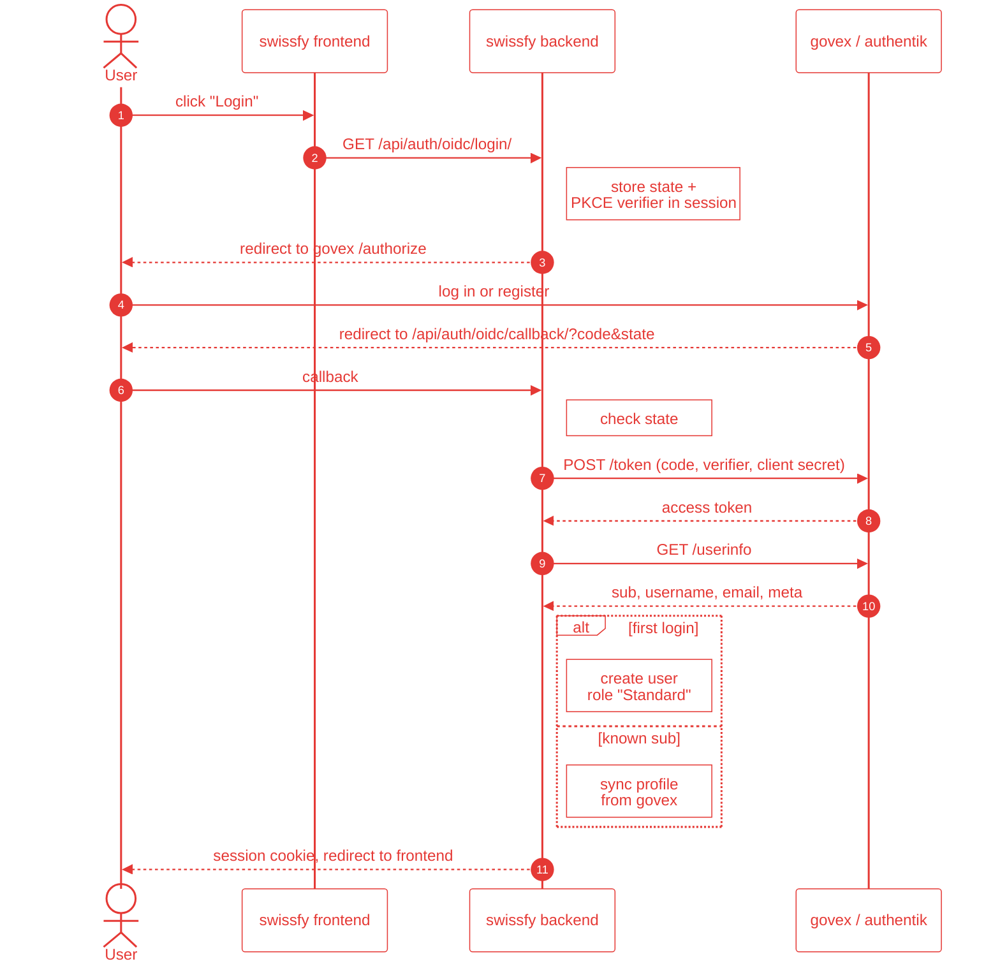

Local accounts are matched by `govex_sub` only, never by email (govex doesn't
verify emails). Existing local accounts are linked with `link_govex_user`.

When a user changes or deletes their account in govex, govex notifies swissfy
right away:

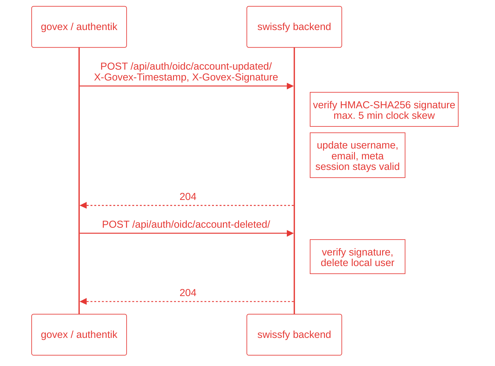

### Chat encryption

Messages are encrypted in the browser. Every message gets a random AES-256-GCM
key; that key is sealed once per recipient device with a hybrid
post-quantum key exchange (ML-KEM-768 + ECDH P-256, combined with HKDF).

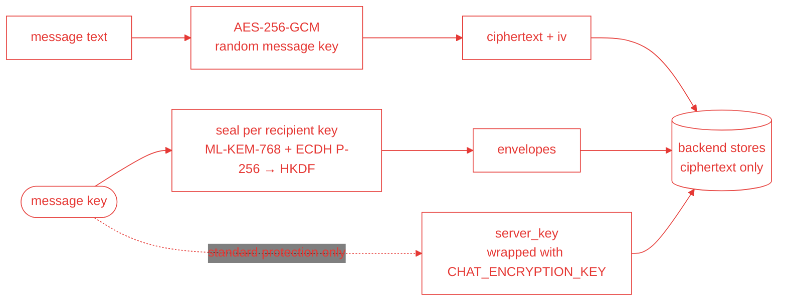

Each user picks a protection level:

| Level      | Where the private key lives                                    | Server can read? |
| ---------- | -------------------------------------------------------------- | ---------------- |
| `standard` | message key is additionally wrapped server side with `CHAT_ENCRYPTION_KEY`, so chats work on every device | yes, with the server key |
| `device`   | non-extractable key in this browser only                       | no               |
| `pin`      | private key encrypted with a PIN (PBKDF2, 600k iterations) and stored on the server | no |

If either participant uses `standard`, the server key is attached. Messages
are deleted after 14 days by `chat-cleanup`, and a slow mode allows one
message every 5 seconds per chat.

### Video pipeline

Uploads are validated synchronously (max. 250 MB, 60 seconds) and transcoded
in the background, so the request returns immediately.

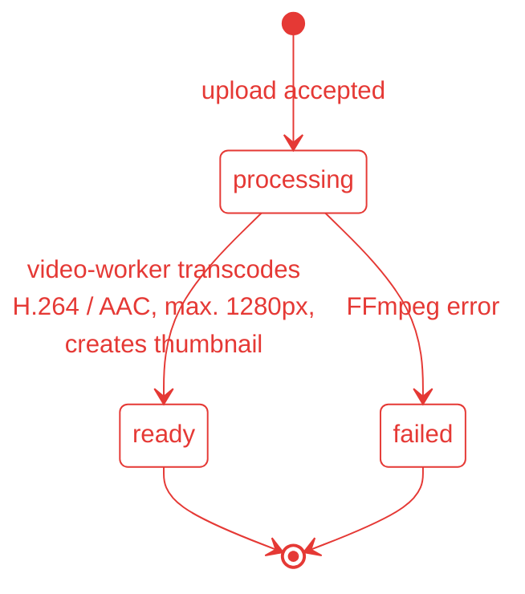

`video-worker` polls every 5 seconds for posts in `processing`.

### Production request flow

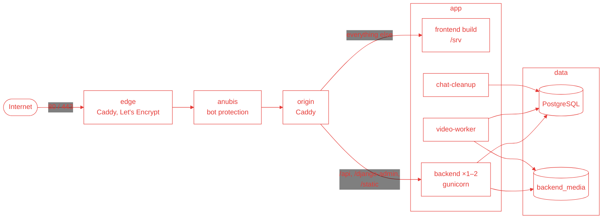

`origin` resolves `backend` via DNS every 5 seconds and health-checks it, which
is what lets `bin/deploy` run two backends side by side during a deploy.

### Release and deploy

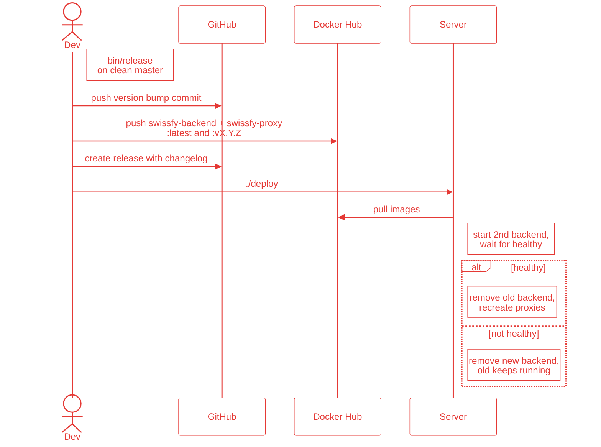

## Prerequisites

- [Docker Desktop](https://www.docker.com/products/docker-desktop/) (or Docker
  Engine with the Compose plugin). Python and Node do **not** need to be
  installed locally, everything runs in containers.
- Git with SSH access to GitHub.
- Optionally, for editor support (autocomplete, linting) outside Docker:
  Python 3.13 and Node `^22.18.0 || >=24.12.0`.
- For releases only: `docker buildx`, an authenticated `gh` and push access to
  the `buechijonas` Docker Hub account.

## Repositories

Two repositories are needed, cloned **next to each other**:

| Repository                                                           | What it is                                     |
| -------------------------------------------------------------------- | ---------------------------------------------- |
| [buechijonas/swissfy](https://github.com/buechijonas/swissfy)        | This repo: the swissfy app                     |
| [NEOTYRA/govex](https://github.com/NEOTYRA/govex)                    | The identity provider; without it nobody can log in |

```sh
mkdir -p ~/projects && cd ~/projects
git clone git@github.com:NEOTYRA/govex.git
git clone git@github.com:buechijonas/swissfy.git
```

```
projects/
├── govex/
└── swissfy/
```

govex already ships with an OIDC client for swissfy in local development
(`swissfy-dev` / `swissfy-dev-secret`, see `govex/compose.yml` and
`govex/authentik/blueprints/govex.yaml`), so no setup is needed on that side.

## Local development

### 1. Start govex

govex runs as its own stack and has to be up first:

```sh
cd ~/projects/govex
docker compose up -d
```

The first start takes a few minutes: authentik migrates its database and
applies the govex blueprints. Wait until http://localhost:5174 shows the govex
login page.

| Service          | URL                                   | Login                  |
| ---------------- | ------------------------------------- | ---------------------- |
| govex            | http://localhost:5174                 | –                      |
| authentik admin  | http://localhost:9000/if/admin/       | `akadmin` / `admin`    |
| Mailpit          | http://localhost:8025                 | – (catches all emails) |

### 2. Start swissfy

```sh
cd ~/projects/swissfy
docker compose up --build
```

This starts:

| Container      | What it does                                                          |
| -------------- | --------------------------------------------------------------------- |
| `db`           | PostgreSQL 17                                                         |
| `backend`      | Runs migrations, creates the admin user, then `runserver` with reload |
| `frontend`     | Vite dev server with hot reload, proxies `/api` to the backend        |
| `video-worker` | Transcodes uploaded videos (`process_videos`)                         |
| `chat-cleanup` | Deletes chat messages older than 14 days, once per hour               |

| Service      | URL                                 | Login             |
| ------------ | ----------------------------------- | ----------------- |
| Frontend     | http://localhost:5175               | via govex         |
| Backend API  | http://localhost:8001/api/          | –                 |
| Health check | http://localhost:8001/api/health/   | –                 |
| Django admin | http://localhost:8001/django-admin/ | `admin` / `admin` |

The ports sit next to wintersehn (5173/8000) and govex (5174), so all three
can run at once.

`backend/` and `frontend/` are mounted into the containers, so code changes
are picked up without a rebuild. Rebuild (`--build`) only after changing
`requirements.txt`, `package.json` or a Dockerfile.

### 3. Log in

1. Open http://localhost:5175 and click login. You are sent to govex.
2. Register a new account there. Verification emails land in Mailpit
   (http://localhost:8025).
3. After registering you are sent back to swissfy, which creates your local
   user from the govex profile.

To make your govex account an admin in swissfy, either give it the `Admin`
role in the Django admin (http://localhost:8001/django-admin/, log in as
`admin` / `admin`), or link an existing swissfy user to your govex identity:

```sh
docker compose exec backend python manage.py link_govex_user <username> <govex-sub>
```

The govex sub is the user's UUID in the authentik admin
(Directory → Users).

### 4. Demo data (optional)

```sh
docker compose exec backend python manage.py seed_demo
```

Creates `demo_*` users with every combination of roles, posts, comments,
relations, chats and sanctions. `--seed <n>` changes the random seed.

## Everyday commands

All run from the swissfy root while the stack is up.

| Task                     | Command                                                                 |
| ------------------------ | ----------------------------------------------------------------------- |
| Backend tests            | `docker compose run --rm backend python manage.py test`                 |
| Tests of one app         | `docker compose run --rm backend python manage.py test posts`           |
| Create migrations        | `docker compose exec backend python manage.py makemigrations`           |
| Apply migrations         | `docker compose exec backend python manage.py migrate`                  |
| Django shell             | `docker compose exec backend python manage.py shell`                    |
| Format backend           | `docker compose exec backend sh -c "isort . && black ."`                |
| Lint backend             | `docker compose exec backend flake8`                                    |
| Lint frontend            | `docker compose exec frontend npm run lint`                             |
| Format frontend          | `docker compose exec frontend npm run format`                           |
| Production build test    | `docker compose exec frontend npm run build`                            |
| Logs of one service      | `docker compose logs -f backend`                                        |
| Stop                     | `docker compose down`                                                   |
| Stop and wipe all data   | `docker compose down -v`                                                |

After a new frontend dependency, refresh the `node_modules` volume:

```sh
docker compose down
docker volume rm swissfy_frontend_node_modules
docker compose up --build
```

## Project structure

```
swissfy/
├── backend/
│   ├── main/            settings, URLs, health check, pagination
│   ├── accounts/        govex login (oidc.py), profile, legal consent,
│   │                    roles, administration, management commands
│   ├── social/          friend/follow requests, friendships, blocks, nicknames
│   ├── posts/           posts, images, videos, reels, comments, hashtags,
│   │                    likes, saved folders, contact groups
│   ├── chats/           encrypted chats, message retention
│   ├── notifications/   notifications
│   ├── moderation/      reports, warnings, suspensions
│   └── achievements/    achievements, themes, easter eggs
├── frontend/
│   ├── src/
│   │   ├── components/  common, layout, legal, posts, moderation, achievements
│   │   ├── views/       pages, incl. auth/ and legal/
│   │   ├── router/      routes
│   │   ├── stores/      Pinia stores (auth, posts, chats, notifications)
│   │   ├── lib/         API client, chat crypto, theme, helpers
│   │   └── data/        navigation, footer, legal texts (data/legal)
│   ├── Caddyfile        production: serves the build, proxies /api
│   └── Caddyfile.edge   production: TLS edge proxy
├── bin/
│   ├── release          cuts a release
│   └── deploy           zero-downtime deploy on the server
├── compose.yml          local development
├── compose.prod.yml     production
└── .env.example         production configuration template
```

Roles are Django groups: `Admin`, `Moderator`, `Verifiziert`, `Standard`.

## Configuration

Locally everything is preset in `compose.yml`; no `.env` is needed. In
production the backend reads these environment variables:

| Variable                      | Description                                                       |
| ----------------------------- | ----------------------------------------------------------------- |
| `DJANGO_DEBUG`                | `true` locally, `false` in production                             |
| `DJANGO_SECRET_KEY`           | Django secret key                                                 |
| `CHAT_ENCRYPTION_KEY`         | Base64 encoded 32-byte AES key for chat messages                  |
| `DJANGO_ALLOWED_HOSTS`        | Comma separated hostnames                                         |
| `DJANGO_CSRF_TRUSTED_ORIGINS` | Comma separated origins                                           |
| `DB_NAME`, `DB_USER`, `DB_PASSWORD`, `DB_HOST`, `DB_PORT` | PostgreSQL connection                 |
| `ADMIN_USERNAME`, `ADMIN_EMAIL`, `ADMIN_PASSWORD` | Django admin created on first start (password is never overwritten later) |
| `GOVEX_PUBLIC_URL`            | govex URL the browser is sent to for login                        |
| `GOVEX_INTERNAL_URL`          | govex URL the backend calls; defaults to `GOVEX_PUBLIC_URL`, only differs in Docker dev |
| `GOVEX_ACCOUNT_URL`           | Where users edit their govex account                              |
| `GOVEX_CLIENT_ID`, `GOVEX_CLIENT_SECRET` | OIDC client, must match govex                          |
| `GOVEX_REDIRECT_URI`          | `https://<domain>/api/auth/oidc/callback/`                        |
| `FRONTEND_URL`                | Public URL of the frontend                                        |

With `DJANGO_DEBUG=false` the backend refuses to start if the secret key, the
chat key or any govex variable is missing.

## Production

Production runs from prebuilt images on Docker Hub
(`buechijonas/swissfy-backend`, `buechijonas/swissfy-proxy`). See
[Architecture → Production request flow](#production-request-flow) for how requests flow.

### Server setup (once)

1. Point the domain's A/AAAA record to the server and open ports 80 and 443.
2. Install Docker with the Compose plugin.
3. Copy `compose.prod.yml`, `bin/deploy` and `.env.example` to the server,
   e.g. to `/opt/swissfy`, and create the `.env`:

   ```sh
   cd /opt/swissfy
   cp .env.example .env
   ```

4. Fill in `.env`. Generate the secrets with:

   ```sh
   python3 -c "import secrets; print(secrets.token_urlsafe(50))"                  # DJANGO_SECRET_KEY
   python3 -c "import base64, os; print(base64.b64encode(os.urandom(32)).decode())" # CHAT_ENCRYPTION_KEY
   ```

   `CHAT_ENCRYPTION_KEY` is not in `.env.example` yet and has to be added by
   hand. Never change it once chats exist, old messages can't be decrypted
   anymore.

5. In govex's `.env`, `SWISSFY_CLIENT_ID` / `SWISSFY_CLIENT_SECRET` must match
   `GOVEX_CLIENT_ID` / `GOVEX_CLIENT_SECRET`, and `SWISSFY_REDIRECT_URI` must be
   `https://<DOMAIN>/api/auth/oidc/callback/`.

6. Start it:

   ```sh
   ./deploy
   ```

### Releasing

From an up-to-date, clean `master`:

```sh
bin/release
```

It asks for the bump type (patch/minor/major), bumps the version in
`frontend/package.json`, commits and pushes, builds and pushes both images for
`linux/amd64` (tagged `latest` and `vX.Y.Z`) and creates a GitHub release with
the commits since the last one as changelog.

### Deploying

On the server:

```sh
cd /opt/swissfy
./deploy
```

It pulls the new images, starts a second backend next to the old one, waits
until it is healthy, removes the old one and then recreates the proxies. If
the new backend doesn't get healthy, it is removed again and the old one keeps
running.

## Troubleshooting

**Login fails or hangs.** govex isn't running or isn't ready yet. Check
`cd ../govex && docker compose ps` and wait until http://localhost:5174 loads.
The backend reaches authentik through `host.docker.internal:9000`, so port
9000 must be free on the host.

**Port already in use.** Another stack (or a local Postgres/Vite) uses 5175,
8001, 5174 or 9000. Stop it, or change the host port in `compose.yml`.

**Frontend misses a package after `npm install`.** The `node_modules` volume is
stale, see [Everyday commands](#everyday-commands).

**Videos stay in "processing".** The `video-worker` isn't running, check
`docker compose logs video-worker`.

**Start over with a clean database.** `docker compose down -v`, then
`docker compose up --build`.
