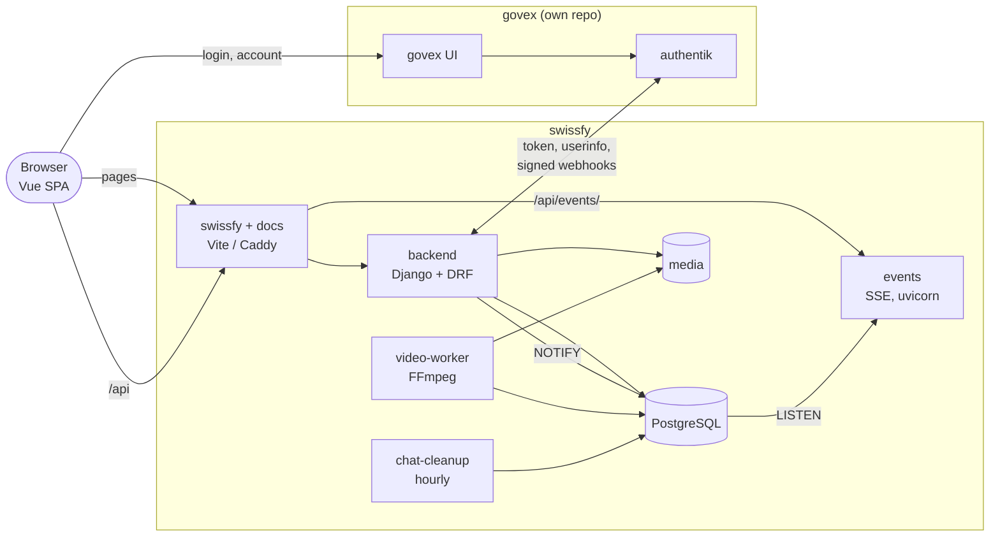
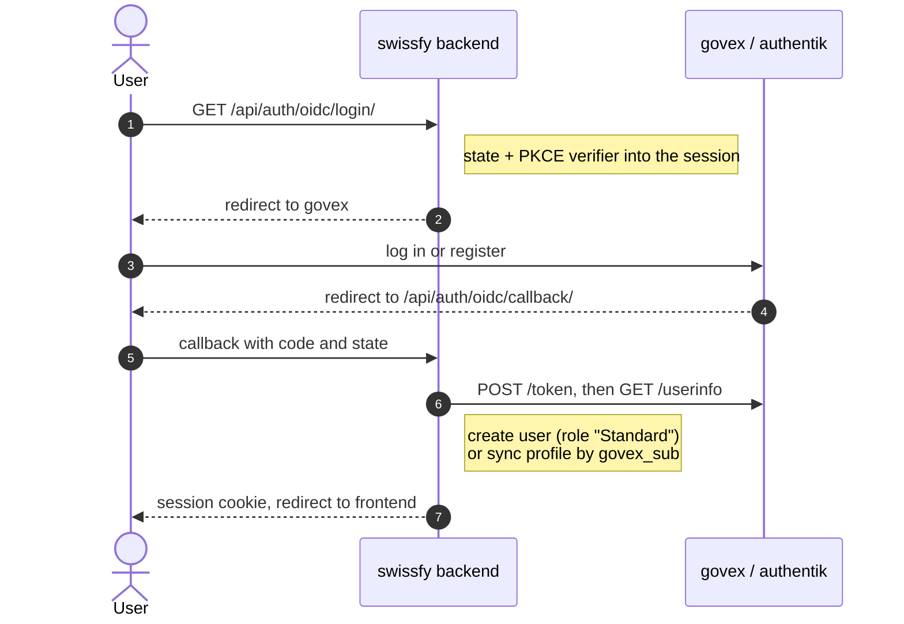
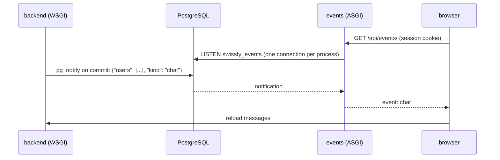
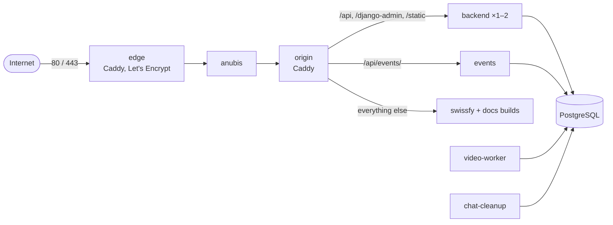

# Swissfy

Swissfy is a social network: posts with images and videos, reels, stories,
comments, hashtags, friends and followers, encrypted chats (end-to-end on
request, see [Chat encryption](#chat-encryption)), notifications, achievements
and moderation.

The repo holds a Django REST backend (`backend/`) and two Vue frontends that
share `frontend/core`: `frontend/swissfy` is the app itself, `frontend/docs` is
the public changelog and the legal pages (imprint, privacy policy, terms of use,
disclaimer) at `docs.swissfy.ch`. Logged-in users still have to agree to the
privacy policy, terms and disclaimer inside swissfy (`/consent/<page>`). The
setup mirrors wintersehn.

Login goes through [govex](https://github.com/NEOTYRA/govex) (authentik, OIDC).
swissfy stores no passwords; username, email, name, birthdate and avatar come
from govex.

## Stack

Backend: Python 3.13, Django 6, Django REST framework, PostgreSQL 17,
cryptography (AES-GCM), Pillow, FFmpeg, gunicorn, uvicorn (server-sent events)
and WhiteNoise.

Frontend: Vue 3 with the Options API, Vue Router, Pinia, Vite, Tailwind 4,
daisyUI 5, vue-i18n, and `@noble/post-quantum` for the chat key exchange.

Infrastructure: Docker Compose locally and in production, Caddy as proxy and
for TLS, and Anubis for bot protection. Images are hosted on Docker Hub.

Exact versions are in `backend/requirements.txt` and the `package.json` files.

## Architecture



The browser only ever talks to one origin. Vite (dev) or Caddy (prod) proxies
`/api` to the backend. Authentication uses a plain Django session cookie, so
there are no tokens in the browser.

### Backend apps

All apps live under `backend/swissfy/` and revolve around the user from
`accounts`. They depend on each other on purpose: a like creates a
notification, a block hides posts and chats, a suspension stops posting. The
direction of those dependencies is fixed, and `lint-imports` checks it in CI
(contracts in `backend/pyproject.toml`).

Models only import models of the apps below them:

```text
achievements → chats → notifications → posts → social → moderation → accounts
```

A reference against that direction is a lazy string: `posts.models` imports
`Report`, and `Report` points back with `"posts.Post"`.

Models and querysets never import views, serializers, URLs or permissions.
Apps never import each other's views. Every app registers its own viewsets,
even below another app's prefix: `achievements/urls.py` and
`moderation/urls.py` add endpoints below `/api/social/profiles/`. The only
exception is the moderation queue, which extends the comment viewsets of
`posts`.

Serializers may nest serializers of other apps. Helpers that several apps need
go to `commons` (`commons.media`), permissions to the app that owns the
concept (`IsNotSuspended` in `moderation`).

| URL prefix             | App                                                             |
| ---------------------- | --------------------------------------------------------------- |
| `/api/auth/`           | `accounts`: login, me, consent                                  |
| `/api/social/`         | `social`: friends, follows, blocks, nicknames                   |
| `/api/chats/`          | `chats`                                                         |
| `/api/` (posts, …)     | `posts`, `moderation`                                           |
| `/api/administration/` | `accounts.administration`                                       |
| `/api/notifications/`  | `notifications`                                                 |
| `/api/internal/`       | `accounts`: profiles for wintersehn's monolith, token protected |
| `/api/docs/`           | `docs`: changelogs, public                                      |
| `/api/health/`         | `main`                                                          |
| `/django-admin/`       | Django admin                                                    |

Every user has a `UserProfile` that holds the link to govex (`govex_sub`).
Roles are Django groups: `Admin`, `Moderator`, `Verifiziert`, `Standard`.

Post texts, comments, stories, biographies and all uploaded media are encrypted
at rest using `CONTENT_ENCRYPTION_KEYS` (`commons/encryption.py`,
`EncryptedTextField`, `EncryptedFileSystemStorage`).

### Login with govex

This is an authorization code flow with PKCE. The code is exchanged server to
server, and the browser only receives swissfy's session cookie.



Accounts are matched by `govex_sub` only, never by email, because govex does
not verify emails. Existing local accounts can be linked with
`link_govex_user`.

govex notifies swissfy about account changes through
`/api/auth/oidc/account-updated/` and `/api/auth/oidc/account-deleted/`.
Both requests are signed with HMAC-SHA256, and swissfy accepts at most 5
minutes of clock skew.

swissfy keeps the consents to its own contracts; govex only shows them.
`accounts/consent.py` signs the consent status (ES256 JWS,
`CONSENT_PRIVATE_KEY`) and pushes it through govex's public attestation flow,
so govex can store it but not forge it. A failed push never raises and is
retried on the next login. The status govex sends back is not verified: it is
only compared with swissfy's own records to see whether govex is outdated.

### Chat encryption

Messages are encrypted in the browser. Each message gets a random AES-256-GCM
key. That key is sealed once per recipient device with ML-KEM-768 + ECDH P-256
combined through HKDF. The backend stores ciphertext and envelopes only.

| Protection | Where the private key lives                                                               | Server can read? | Forward secrecy |
| ---------- | ----------------------------------------------------------------------------------------- | ---------------- | --------------- |
| `standard` | the message key is also wrapped with `CHAT_ENCRYPTION_KEY`, so chats work on every device | yes              | no              |
| `device`   | non-extractable key in this browser only                                                  | no               | 14 days         |
| `pin`      | encrypted with a PIN (PBKDF2, 600k iterations), stored on the server                      | no               | no              |

If either participant uses `standard`, the server key is attached. Messages
are deleted after 14 days by `chat-cleanup`. Slow mode allows one message
every 5 seconds per chat.

Every key has a signing identity (ECDSA P-256) that endorses its encryption
keys. In `device` mode the browser rotates the encryption keys every 7 days
under the same identity (`prepareChatKeys` in `src/lib/chatKeys.js`) and
deletes a retired private key once `CHAT_RETENTION_DAYS` have passed, when no
message sealed for it can be left on the server. Someone who steals a device
key therefore reads at most the last two weeks. Partners keep trusting a
rotated key because a trusted identity endorsed it, and safety numbers cover
the identity only, so rotation never changes them. `pin` cannot offer forward
secrecy: new devices are meant to read old messages with the PIN. A server
that keeps handing out an old, still endorsed key is not detected; that only
affects messages sent after a key was stolen.

Messages are versioned (`Message.version`). Clients send v2, which binds every
part of a message to its context:

- The key that wraps the message key is derived from the whole exchange. The
  HKDF salt is a hash of key id, KEM ciphertext and ephemeral ECDH key, as in
  X-Wing, and the same data is the AAD of the wrapped key.
- The text is encrypted with sender and recipient as AAD, so the server cannot
  show it in another chat or turn its direction.
- The signature covers version, sender, recipient, signing key, ciphertext and
  all envelopes, and the signing key has to belong to the sender.
- Send time and a random nonce travel inside the ciphertext. A message that
  arrives more than 24 hours after it was sent, or whose nonce the chat
  already holds, shows as not verified.

v1 messages stay readable. A v2 message cannot be read or verified as v1, so
it cannot be downgraded. `tests/security/chatCrypto.test.js` covers all of
this.

The server still hands out the keys, and only people who compare safety
numbers notice a key it slipped in. Replays are caught within the loaded
history, and by send time alone once `chat-cleanup` deleted the original. The
server sees who writes to whom, when and how much. A PIN holds against a
database dump, because the wrapped key is encrypted at rest and the PIN
verifier is an HMAC with `CHAT_ENCRYPTION_KEY`. It does not hold against
someone who controls the server and its keys: they can try PINs offline, and
six digits do not last long. The building blocks are standard (WebCrypto,
`@noble/post-quantum`), but the protocol that combines them is our own and
has not been audited.

### Live updates

The browser keeps one server-sent event stream open (`/api/events/`). Events
carry no content, only which part changed (`chat` or `notification`); the
client then reloads it through the normal, authenticated API.



`commons.events.publish` sends the notification through
`transaction.on_commit`, so a client never reloads before the change is
committed. Changes that do not alter a row (marking an already read message as
read) send nothing, which keeps the reload loop from echoing. The stream lives
in its own `events` service (`main.asgi` under uvicorn), so long-lived
connections never take away the gunicorn threads of the API. On every
(re)connect the stream sends `sync` and the client reloads everything it
missed.

### Videos

Uploads are validated in the request (max. 250 MB, 60 seconds) and get the
status `processing`. `video-worker` (`manage.py process_videos`) picks them up
every 5 seconds and transcodes them to H.264/AAC with at most 1280px and a
thumbnail. The post then ends up as `ready` or `failed`.

### Production



`edge` tags each request with `X-Swissfy-App` (`swissfy` or `docs`), and
`origin` serves the matching build. `origin` resolves `backend` via DNS every
5 seconds and health-checks it. That is what lets `bin/deploy` run two
backends side by side.

## Code culture

The code follows a strong house style. It is consistent throughout, and it is
unusual enough that it is worth reading this section before your first change.

The strictness is deliberate. Vibe coding produces masses of bloated,
unreadable code: defensive checks for cases that cannot happen, comments that
repeat the line below, a new helper for every problem and three ways of doing
the same thing. It is painful to read, painful to debug, painful to review and
painful to change. Nobody really understands it, including whoever generated
it.

This codebase does not accept that. The style is narrow on purpose, so that
kind of code stands out in review right away. Every change has to fit the
existing patterns, and fitting them means understanding them first.

When in doubt, find the place where the same problem is already solved and do
it the same way.

### Backend

**Logic lives in querysets and models, not in views.** Views chain named
queryset methods that read like the domain:

```python
Post.objects.feed(user).videos()
SavedPost.objects.filter(user=user).in_folder(folder)
PostCreation.objects.filter(author=user).stale().delete()
```

Each model's queryset implements `apply_acl(user)`, which returns exactly what
the user may see. Visibility is built in SQL from `Q` and `Exists`
(`AudienceQuerySet.with_audience`), never by filtering in Python. A new
endpoint starts from `apply_acl`, not from `objects.all()`.

**Views are thin and configured, not branched.** Every viewset extends
`commons.views.BaseViewSet`:

- `permission_action_classes` and `pagination_action_classes` map an action to
  its permissions or pagination, which replaces `if self.action == ...`.
- `respond(instance)` reloads the instance through `get_queryset()`, so the
  response carries the same annotations as a list.
- `CreateModelMixin` and `UpdateModelMixin` from `commons.views` return through
  `respond`. `perform_create` returns the saved object.

**Serializers are grouped into variants.** A `BaseModelSerializer` is not a
serializer itself. It is a container of nested serializer classes:

```python
class PostModelSerializer(UUIDModelSerializer):
    class read(...): ...
    class write(...): ...
    class audience(...): ...
```

`for_action` picks `read` for `list`/`retrieve` and `write` for everything
else. Other variants (`.audience`, `.device`, `.query`) are chosen explicitly.
Query parameters are validated through a serializer too, not read raw.

**The server decides, the client displays.** States like `can_request`,
`blocked_reason`, `unavailable` and `can_view` are computed in the backend and
sent ready to use. The frontend does not recompute permissions.

**Concurrency is handled explicitly.** Anything that counts or limits locks
first: `select_for_update` for the post quota and `lock_users` before chat
messages and chat requests, both inside `transaction.atomic`.

**User-facing messages are translated** into English, German, French, Italian,
Romansh, Spanish and simplified Chinese. The source language is English, the
same as `LANGUAGE_CODE`, wrapped in `gettext_lazy` (`_("…")`), with one
catalog per language in `backend/locale/*/LC_MESSAGES/django.po`. Placeholders
are named (`_("Your account is suspended until %(until)s.") % {"until": until}`),
never f-strings. Messages are raised directly from the backend (`BadRequest`,
`Conflict`, `RetryLater` in `commons.exceptions`), and the frontend shows
`error.detail` as it is. Larger content that is not code, like the achievement
texts, lives as JSON with one entry per language (`achievements/data/`) and is
read through `commons.i18n.localized`, which falls back to English.

`bin/translations` updates the catalogs. When a msgid changes, gettext guesses
a translation and marks it fuzzy. CI rejects fuzzy entries, so check the guess
in every language. Compact numbers (`main.numbers.compact_number`) are
translated too, unit and decimal separator: `12 Tsd.`, `1,5 Mio.`, `1.5M`.

The language is resolved the same way everywhere: the `language` cookie if the
user picked one, otherwise the first supported browser language, otherwise
English. The cookie is only written when someone picks a language. The API
client sends the resolved language as `Accept-Language`, so frontend and
backend always agree. `LANGUAGE_CODE` is English for that fallback; the test
runner (`main.testing.GermanTestRunner`) switches to German, so the tests
assert the German texts and cover the German catalog on the way. Run
`compilemessages` before the tests (`compose.yml` and CI do).

### Rules that apply everywhere

- No comments and no docstrings. A name that needs a comment is the wrong
  name.
- No `getattr`, `setattr`, `isinstance`, `defaultdict` or
  `operator.attrgetter` in Python. No `setTimeout` or `nextTick` in Vue. They
  usually hide a missing structure; solve it with an explicit mapping, a
  variant or a separate method instead.
- Short names from the domain: `respond`, `paginated`, `like_state`,
  `incoming_request`.
- An exception raised in `except` names its cause: `from error` when the cause
  helps to debug (an image, ffmpeg, the network), `from None` when it is only
  control flow (an invalid page number, a duplicate warning).
- Formatting is not up for discussion. CI fails otherwise, as it does for
  missing migrations. The backend uses `ruff format` and `ruff check` (rules in
  `backend/pyproject.toml`), `bin/house-rules` for what Ruff cannot check (the
  calls above and docstrings) and `lint-imports` for the app boundaries. The
  frontend uses Prettier with the Tailwind plugin, ESLint and oxlint.

### Frontend

- Components use the Options API (`export default { data, computed, methods }`).
  Stores use Pinia's setup syntax.
- Every request goes through a module in `src/api/`, which builds on
  `@core/api/client.js`. Components do not build URLs.
- Styling uses Tailwind and daisyUI classes in the template, with the shared
  components from `components/common` (`BaseButton`, `BaseCard`, `AppIcon`,
  …). Every button has an `AppIcon`.
- Shared logic never comes from mixins, so every name in a component has a
  visible origin. Pick by what is shared:
  - Stateless logic is a plain function in `src/lib/` (chat crypto, time,
    links, bubble geometry).
  - State with its own lifecycle is a composable in `src/composables/` (or
    `core/src/composables/`). Components create it under one name in
    `data()`, not in `setup()`, and use it as `action.busy`, `feed.posts`,
    `taps.tap(…)`, `clock.now`. `data()` runs in the component's scope, so
    timers stop when the component unmounts. Props are read through `this`:
    `usePostFeed({ url: () => this.url })`.
  - State that has to be wired into the template of its user is a renderless
    component that hands its state to a scoped slot (`BubbleNavigation`).
- Every text goes through vue-i18n: `$t('…')` in templates, `t('…')` from
  `@/i18n.js` in scripts. Messages live in `src/locales/<language>.json`,
  shared ones in `core/src/locales`. The language switches without a reload,
  so a translated text is never stored once: option lists are functions that
  components use as `computed`, route titles are functions, and prop defaults
  fall back to `t()` in a `computed`.
- `bin/i18n` checks that every language has every key, that every key used in
  the code exists, that the legal texts have the same structure in every
  language, and that the backend catalogs and achievement data are complete.
  CI runs it.
- Live data reacts to `useEventsStore()` (`chat`, `notification` counters)
  instead of polling.
- ESLint and oxlint enforce the rules above: no `setup()`, `mixins`,
  `setTimeout` or `nextTick` (tests wait with `flushPromises()`), a fixed order
  of component options and template attributes, and sorted imports (packages,
  `@core/…`, `@/…`, relative). Prettier sorts Tailwind classes. `frontend/core`
  has no config of its own and is checked with the swissfy config.
- Exceptions live in `.oxlintrc.json`, not in comments.
  `unicorn/consistent-function-scoping` is off for Pinia setup stores, and
  `PostMediaPicker.vue` may await in a loop: it compresses one image at a time,
  because ten at once can crash a phone's tab.
- Dependencies use `^` ranges, and `package-lock.json` pins them. Prettier, its
  Tailwind plugin and `@noble/post-quantum` are pinned exactly, because their
  updates change the formatting or the crypto.

### Tests

Tests are Django `TestCase`s next to the app and split by intent:

| File                       | What it covers                                         |
| -------------------------- | ------------------------------------------------------ |
| `tests.py`                 | behaviour of the endpoints                             |
| `test_security.py`         | access control, input that must be rejected            |
| `test_matrix.py`           | every combination of visibility, audience and relation |
| `main/test_performance.py` | query counts, so N+1 regressions fail                  |

Frontend tests (Vitest) live in `frontend/swissfy/tests`, with security tests
for rendering, links and chat crypto under `tests/security`.

### Performance

`with_details` adds about ten subqueries per post, but PostgreSQL evaluates
them after `LIMIT`, for the rows of one page only. What grows with the data is
the set of rows before the sort, so `FeedOrder` pages through day windows
(`FEED_WINDOW`) and widens a window only when it holds too few posts.

Measured with 5000 users, 200,000 posts, a million likes and 200,000 comments
on PostgreSQL 17, best of three:

| Endpoint                                    | Time     | Queries |
| ------------------------------------------- | -------- | ------- |
| feed, pages 1 to 5                          | 45–58 ms | 9       |
| global feed                                 | 33 ms    | 8       |
| reels                                       | 17 ms    | 4       |
| saved, profile posts, post detail, comments | 21–33 ms | 5–8     |

`main/test_performance.py` makes sure the number of queries does not grow with
the data, and that later pages of a busy day still stay inside the window.

## Getting started

You need Docker with Compose and SSH access to GitHub. Python and Node are only
needed locally for editor support (Python 3.13, Node `^22.18.0 || >=24.12.0`).

Clone govex next to swissfy:

```sh
cd ~/projects
git clone git@github.com:NEOTYRA/govex.git
git clone git@github.com:buechijonas/swissfy.git
```

govex already ships with a dev OIDC client for swissfy
(`swissfy-dev` / `swissfy-dev-secret`), so no setup is needed on that side.

Start govex first. The first start takes a few minutes, until
http://localhost:5174 shows the login page:

```sh
cd ~/projects/govex && docker compose up -d
```

Then start swissfy:

```sh
cd ~/projects/swissfy && docker compose up --build
```

| Container      | What it does                                                   |
| -------------- | -------------------------------------------------------------- |
| `db`           | PostgreSQL 17                                                  |
| `backend`      | migrates, creates the admin user, runs `runserver` with reload |
| `swissfy`      | Vite dev server for the app                                    |
| `docs`         | Vite dev server for the changelog                              |
| `events`       | server-sent events (uvicorn), `/api/events/`                   |
| `video-worker` | transcodes uploaded videos                                     |
| `chat-cleanup` | deletes chat messages older than 14 days, hourly               |

| Service         | URL                                 | Login               |
| --------------- | ----------------------------------- | ------------------- |
| swissfy         | http://localhost:5175               | via govex           |
| docs            | http://localhost:5176               | public              |
| API             | http://localhost:8001/api/          | –                   |
| Django admin    | http://localhost:8001/django-admin/ | `admin` / `admin`   |
| govex           | http://localhost:5174               | –                   |
| authentik admin | http://localhost:9000/if/admin/     | `akadmin` / `admin` |
| Mailpit         | http://localhost:8025               | –                   |

The ports do not collide with wintersehn (5173/8000), so all three stacks can
run at once. The source code is mounted into the containers. Only changes to
`requirements.txt`, `package.json` or a Dockerfile need `--build`.

To log in, open http://localhost:5175 and register in govex. Verification
emails end up in Mailpit. To make your account an admin, give it the `Admin`
group in the Django admin, or link it to an existing swissfy user:

```sh
docker compose exec backend python manage.py link_govex_user <username> <govex-sub>
```

The govex sub is the user's UUID in the authentik admin, under
Directory → Users.

For demo data, run `docker compose exec backend python manage.py seed_demo`.
It creates `demo_*` users with every combination of roles, posts, relations,
chats and sanctions. `--seed <n>` changes the seed.

## Everyday commands

Run these from the repo root while the stack is up.

| Task                   | Command                                                                               |
| ---------------------- | ------------------------------------------------------------------------------------- |
| Backend tests          | `docker compose run --rm backend python manage.py test`                               |
| Tests of one app       | `docker compose run --rm backend python manage.py test swissfy.posts`                 |
| Migrations             | `docker compose exec backend python manage.py makemigrations`                         |
| Django shell           | `docker compose exec backend python manage.py shell`                                  |
| Format backend         | `docker compose exec backend sh -c "ruff format . && ruff check --fix ."`             |
| Lint backend           | `docker compose exec backend sh -c "ruff check . && bin/house-rules && lint-imports"` |
| Update translations    | `docker compose exec backend bin/translations`                                        |
| Check translations     | `bin/i18n`                                                                            |
| Frontend tests         | `docker compose exec swissfy npm test`                                                |
| Lint / format frontend | `docker compose exec swissfy npm run lint` / `npm run format` (same for `docs`)       |
| Production build       | `docker compose exec swissfy npm run build`                                           |
| Proxy image test       | `bin/test-proxy`                                                                      |
| Wipe all data          | `docker compose down -v`                                                              |

After adding a frontend dependency, the `node_modules` volume needs to be
recreated:

```sh
docker compose down
docker volume rm swissfy_swissfy_node_modules   # or swissfy_docs_node_modules
docker compose up --build
```

## Project structure

```
backend/
  main/          settings, URLs, health, events stream, pagination, middleware
  locale/        translation catalogs (one per language)
  commons/       base viewset, serializer and model classes, encryption, storage,
                 events (LISTEN/NOTIFY), i18n helpers
  swissfy/
    accounts/    govex login (oidc.py), profile, consent, roles, administration
    social/      friend and follow requests, blocks, nicknames
    posts/       posts, stories, videos, comments, hashtags, saved, contact groups
    chats/       encrypted chats and keys
    notifications/
    moderation/  reports, warnings, suspensions
    achievements/ badges, themes, easter eggs (texts in data/*.json)
  docs/          changelogs (changelogs/vX.Y.Z.md)
frontend/
  core/src/      shared by both apps: API client, cookies, settings, fonts, i18n,
                 legal texts (legal/) shown in docs and on the consent pages
  swissfy/src/   api/, components/, views/, stores/, lib/, data/, router/
  docs/src/      changelog app
docker/proxy/    production Caddy image, builds both frontends
bin/             release, deploy, test-proxy
```

## Production

Production runs on prebuilt images (`buechijonas/swissfy-backend`,
`buechijonas/swissfy-proxy`) with `compose.prod.yml`, `bin/deploy` and a `.env`
on the server, usually in `/opt/swissfy`. The DNS records for the domain and
`docs.<domain>` must point to the server, with ports 80 and 443 open.

### `.env`

`.env.example` is the template. Hostnames, origins, the cookie domain and the
redirect URI are derived from `DOMAIN` in `compose.prod.yml`.

| Variable                                          | Purpose                                                                    |
| ------------------------------------------------- | -------------------------------------------------------------------------- |
| `DOMAIN`, `ACME_EMAIL`                            | public domain and Let's Encrypt contact                                    |
| `DJANGO_SECRET_KEY`                               | Django secret key                                                          |
| `CONTENT_ENCRYPTION_KEYS`                         | `id:key` list, newest first, for content and media at rest                 |
| `CHAT_ENCRYPTION_KEY`                             | server key for `standard` chat protection                                  |
| `CONSENT_PRIVATE_KEY`                             | signs the consent status pushed to govex (`manage.py consent_signing_key`) |
| `DB_NAME`, `DB_USER`, `DB_PASSWORD`               | PostgreSQL                                                                 |
| `ADMIN_USERNAME`, `ADMIN_EMAIL`, `ADMIN_PASSWORD` | Django admin, created once and never overwritten                           |
| `GOVEX_PUBLIC_URL`, `GOVEX_ACCOUNT_URL`           | govex login and account page                                               |
| `GOVEX_CLIENT_ID`, `GOVEX_CLIENT_SECRET`          | must match `SWISSFY_CLIENT_*` in govex's `.env`                            |
| `MONOLITH_API_TOKEN`                              | enables `/api/internal/` for wintersehn; empty disables it                 |

Generate the secrets:

```sh
python3 -c "import secrets; print(secrets.token_urlsafe(50))"
python3 -c "import base64, os; print(base64.b64encode(os.urandom(32)).decode())"
```

`CHAT_ENCRYPTION_KEY` is missing from `.env.example` and has to be added by
hand. Do not change it once chats exist, and never drop a content key that is
still in use, or the data can no longer be decrypted.

`DJANGO_DEBUG` defaults to `false`, so a missing variable can never turn on
debug mode in production; `compose.yml` sets it to `true` for development.
With `DJANGO_DEBUG=false` the backend refuses to start if a secret, an
encryption key, the consent key or a govex variable is missing.

### Release and deploy

`bin/release` runs on a clean, up-to-date `master`. It asks for the bump type,
bumps `frontend/swissfy/package.json`, writes
`backend/docs/changelogs/vX.Y.Z.md`, commits and pushes. Then it builds and
pushes both images for `linux/amd64` (`latest` and `vX.Y.Z`) and creates a
GitHub release.

On the server, `./deploy` pulls the images and starts a second backend next to
the old one. Once the new one is healthy, it removes the old backend and
recreates the proxies. If the new backend never becomes healthy, it is removed
and the old one keeps running.

## Troubleshooting

**Login fails or hangs.** govex is not up yet. The backend reaches authentik
through `host.docker.internal:9000`, so port 9000 has to be free.

**Port already in use.** 5174, 5175, 5176, 8001 or 9000 is taken by another
stack. Stop it or change the port in `compose.yml`.

**A package is missing after `npm install`.** The `node_modules` volume is
stale, see [Everyday commands](#everyday-commands).

**Videos stay in "processing".** Check `docker compose logs video-worker`.
